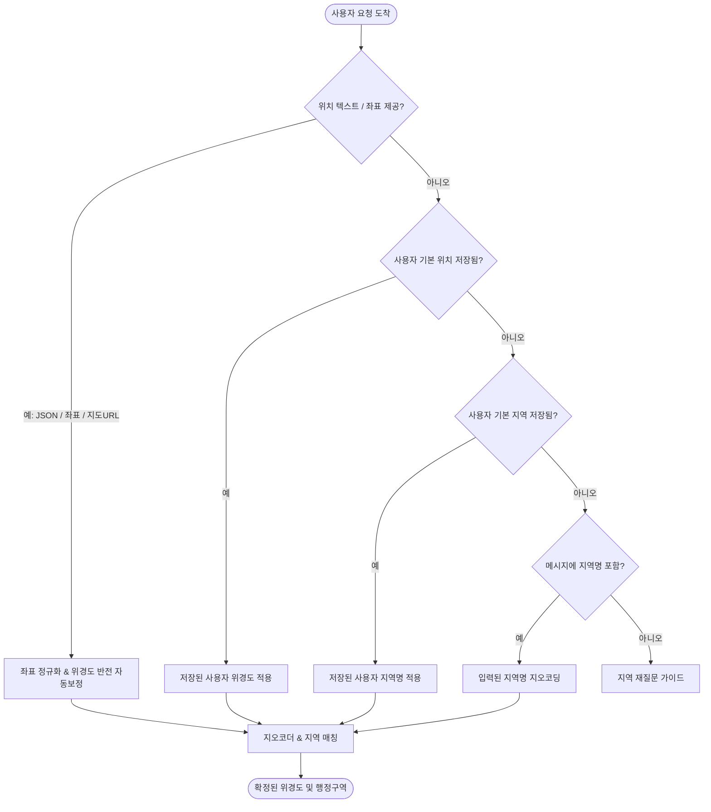
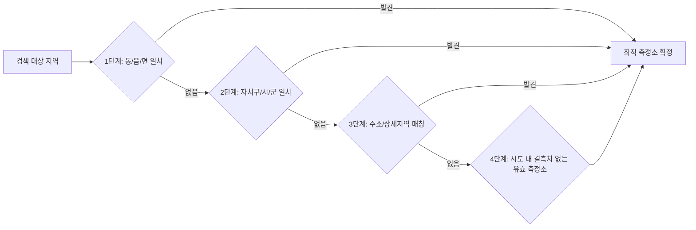

# 🌫️ OpenClaw Korea Air Quality (`korea-air-quality`)

[](https://www.python.org/)
[](LICENSE)
[-orange.svg)]()
[]()
[](https://openclaw.ai)

> **대한민국 전역의 실시간 대기질(초미세먼지·미세먼지·오존·통합대기), 위치 기반 측정소 자동 매칭, 기상 결합 아침 브리핑, 임계치 초과 알림 및 Cron 자동화를 제공하는 OpenClaw 공식 올인원 AgentSkill & CLI 엔진**

대한민국 공공데이터포털 **한국환경공단 에어코리아(AirKorea, ver 1.3)** 실측 API와 전 세계 기상 API인 **Open-Meteo**를 지능적으로 결합하여, **API 키 없이도 즉시 실행(0-Config Fallback)** 되며 공공데이터 인증키 등록 시 전국 600여 개 측정소의 고정밀 실측 데이터까지 완벽하게 제공합니다.

---

### 🏷️ Search Keywords & Topics
`미세먼지` `초미세먼지` `대기질` `에어코리아` `공공데이터포털` `AirKorea` `Open-Meteo` `PM2.5` `PM10` `통합대기환경지수` `KHAI` `오존` `날씨브리핑` `대기질알림` `OpenClaw` `AgentSkill` `AI에이전트` `크론봇` `텔레그램봇` `디스코드봇` `KoreaAirQuality`

---

## 📑 목차 (Table of Contents)

1. [✨ 핵심 차별점 (Why OpenClaw Korea Air Quality?)](#-핵심-차별점-why-openclaw-korea-air-quality)
2. [🏗️ 시스템 아키텍처 & 데이터 파이프라인](#️-시스템-아키텍처--데이터-파이프라인)
3. [⚡ 30초 퀵 스타트 (Quick Start)](#-30초-퀵-스타트-quick-start)
4. [📖 전체 CLI 기능 레퍼런스 (Command Reference)](#-전체-cli-기능-레퍼런스-command-reference)
   - [1. 현재 대기질 실시간 조회 (`now`)](#1-현재-대기질-실시간-조회-now)
   - [2. 기상 결합 모바일 아침 브리핑 (`morning-brief`)](#2-기상-결합-모바일-아침-브리핑-morning-brief)
   - [3. 복수 지역 실시간 비교 (`compare`)](#3-복수-지역-실시간-비교-compare)
   - [4. 사용자 맞춤 개인화 설정 (`save-default`, `save-location`, `clear-default`)](#4-사용자-맞춤-개인화-설정-save-default-save-location-clear-default)
   - [5. 프로바이더 및 에어코리아 API 키 설정 (`setup-provider`, `show-config`)](#5-프로바이더-및-에어코리아-api-키-설정-setup-provider-show-config)
   - [6. 대기질 감시 및 임계치 알림 관리 (`alert-*`)](#6-대기질-감시-및-임계치-알림-관리-alert-)
   - [7. OpenClaw Cron 자동화 작업 생성 (`cron-plan`)](#7-openclaw-cron-자동화-작업-생성-cron-plan)
5. [📊 대기질 지표 및 환경부 등급 판정 기준표](#-대기질-지표-및-환경부-등급-판정-기준표)
6. [🔑 공공데이터포털(에어코리아) 연동 및 트러블슈팅](#-공공데이터포털에어코리아-연동-및-트러블슈팅)
7. [🧩 프로젝트 구조 및 소프트웨어 설계 원칙](#-프로젝트-구조-및-소프트웨어-설계-원칙)
8. [🤖 OpenClaw AgentSkill 연동 가이드](#-openclaw-agentskill-연동-가이드)

---

## ✨ 핵심 차별점 (Why OpenClaw Korea Air Quality?)

| 주요 기능 | 일반적인 대기질 API 스크립트 | **OpenClaw Korea Air Quality** |
| :--- | :--- | :--- |
| **초기 실행성** | API 키 발급 및 승인 대기 필수 | **Zero-Config (Open-Meteo 자동 폴백으로 즉시 실행)** |
| **외부 의존성** | `requests`, `bs4` 등 외부 패키지 다수 설치 | **Python 3 표준 라이브러리(`urllib`)만으로 100% 동작** |
| **측정소 매칭** | 동 이름 미일치 시 엉뚱한 시도 첫 번째 측정소 할당 | **4단계 지능형 계층 매칭 (동 ➔ 구 ➔ 행정동 ➔ 시도 유효소)** |
| **공공데이터 인증** | Encoding/Decoding 키 불일치 시 401 Unauthorized 에러 | **Unquoted/Raw 4중 자동 재시도 + XML 에러 상세 파싱** |
| **위치 인식** | 오직 위경도 숫자만 지원 | **자연어 지명, 좌표, (경도, 위도) 반전, 지도 공유 링크 자동 인식** |
| **알림 & 크론** | 단순 1회성 스크립트 | **중복 알림 억제 상태 머신 + OpenClaw 네이티브 Cron Plan 지원** |
| **에러 내성** | 1개 도시 에러 시 전체 중단 | **복수 도시 조회 시 부분 오류 격리 및 정상 결과 무중단 반환** |

---

## 🏗️ 시스템 아키텍처 & 데이터 파이프라인

### 1) 위치 결정 파이프라인 (Location Resolution Priority)
메신저나 챗봇에서 사용자가 어떤 형태로 위치를 전달하든 최적의 위치를 지능적으로 확정합니다.



### 2) 4단계 계층형 측정소 매칭 (Hierarchical Station Fallback)
에어코리아 연동 시 `명동`, `을지로동`처럼 자체 측정소가 없는 행정동을 조회할 때 무관한 측정소로 튀지 않고 안전하게 상위 자치구 측정소를 찾습니다.



---

## ⚡ 30초 퀵 스타트 (Quick Start)

외부 라이브러리 설치가 필요 없습니다. Python 3.10 이상이 설치된 환경이라면 즉시 실행 가능합니다.

```bash
# 1. 저장소 클론
git clone https://github.com/twbeatles/openclaw-korea-air-quality.git
cd openclaw-korea-air-quality

# 2. 지금 바로 서울 대기질 조회 (키 없이 즉시 실행)
python scripts/air_quality.py now "서울"

# 3. 날씨와 결합된 아침 브리핑 출력
python scripts/air_quality.py morning-brief "서울 강남구"

# 4. 여러 지역 대기질 한 번에 비교
python scripts/air_quality.py compare 서울 수원 부산 제주
```

### 🖥️ 실제 터미널 출력 예시 (`now`)
```text
서울특별시 서울 기준 대기질이야.
- 측정 시각: 2026-09-26T16:00
- 초미세먼지(PM2.5): 14.0 μg/m³ · 좋음
- 미세먼지(PM10): 28.0 μg/m³ · 좋음
- 오존: 0.038 ppm · 보통
- 종합 판단: 보통
- 한줄 팁: 야외 활동과 실내 환기를 하기에 무난한 환경이에요.
- 지역 결정 방식: query
- 공급자: openmeteo
```

---

## 📖 전체 CLI 기능 레퍼런스 (Command Reference)

진입점은 [scripts/air_quality.py](file:///c:/twbeatles-repos/openclaw-korea-air-quality/scripts/air_quality.py) 또는 `src/airquality/app.py`를 통해 실행됩니다.

### 1. 현재 대기질 실시간 조회 (`now`)
지정된 지역 또는 현재 위치의 실시간 대기질을 조회합니다.

```bash
# 1) 자연어 지역명 조회 (시/도, 구/군, 동/읍/면, 주요 랜드마크 지원)
python scripts/air_quality.py now "서울 종로구"
python scripts/air_quality.py now "판교"
python scripts/air_quality.py now "해운대"

# 2) 위경도 좌표 직접 전달 (부산역 인근)
python scripts/air_quality.py now --lat 35.1152 --lon 129.0422

# 3) 메신저 위치 공유 텍스트 / 지도 링크 입력 (경도-위도 순서 반전 자동 감지)
python scripts/air_quality.py now --location-text "126.9780, 37.5665"
python scripts/air_quality.py now --location-text '{"latitude": 37.4979, "longitude": 127.0276}'

# 4) 프로바이더 명시 (공공데이터 실측 에어코리아 강제)
python scripts/air_quality.py now "성동구" --provider airkorea

# 5) JSON 규격 데이터 출력 (REST API 및 에이전트 파싱용)
python scripts/air_quality.py now "여의도" --json
```

---

### 2. 기상 결합 모바일 아침 브리핑 (`morning-brief`)
당일 기온, 최고/최저 기온, 강수 확률, 기상 상태와 함께 미세먼지 수치 및 맞춤형 행동 요령을 한눈에 보기 쉬운 모바일 친화형으로 브리핑합니다.

```bash
# 자연어 지역 브리핑
python scripts/air_quality.py morning-brief "대전 유성구"

# 등록된 사용자의 기본 지역 기반 브리핑
python scripts/air_quality.py morning-brief --user telegram:user_12345
```

**출력 예시:**
```text
대전 유성구 아침 브리핑
- 날씨: 맑음 / 11.2~24.5°C
- 강수 확률: 0%
- 초미세먼지: 12.0 μg/m³ · 좋음
- 미세먼지: 25.0 μg/m³ · 좋음
- 종합 판단: 좋음
- 한줄 요약: 맑고 쾌적한 날씨예요. 환기나 야외활동을 즐기기 아주 좋습니다.
```

---

### 3. 복수 지역 실시간 비교 (`compare`)
여러 지역의 대기질을 한 번에 비교합니다. 일부 지역에 오타가 있거나 통신 지연이 발생해도, 정상 지역은 중단 없이 안전하게 반환됩니다.

```bash
python scripts/air_quality.py compare 서울 수원 대구 광주 부산 제주
```

**출력 예시:**
```text
- 서울특별시 서울: PM2.5 14.0(좋음), PM10 28.0(좋음), 종합 보통
- 경기도 수원: PM2.5 18.0(보통), PM10 35.0(보통), 종합 보통
- 부산광역시 부산: PM2.5 8.0(좋음), PM10 18.0(좋음), 종합 좋음
- 제주특별자치도 제주: PM2.5 6.0(좋음), PM10 15.0(좋음), 종합 좋음
```

---

### 4. 사용자 맞춤 개인화 설정 (`save-default`, `save-location`, `clear-default`)
사용자별(채널 ID, 유저명 등) 기본 거주지 또는 근무지를 로컬에 안전하게 영구 저장합니다.

```bash
# 1) 기본 지역명 저장
python scripts/air_quality.py save-default user_twbeatles "성남시 분당구"

# 2) 기본 GPS 좌표 저장
python scripts/air_quality.py save-location user_twbeatles 37.3827 127.1189 --label "분당 서현동"

# 3) 저장된 기본 설정 확인
python scripts/air_quality.py show-default user_twbeatles --json

# 4) 지역 지정 없이 사용자 기본 설정으로 즉시 조회
python scripts/air_quality.py now --user user_twbeatles

# 5) 사용자 설정 초기화(삭제)
python scripts/air_quality.py clear-default user_twbeatles
```

---

### 5. 프로바이더 및 에어코리아 API 키 설정 (`setup-provider`, `show-config`)
기본 프로바이더를 전역 설정하고 에어코리아 API 키를 등록합니다.

```bash
# 에어코리아로 기본 전환 및 인증키 저장
python scripts/air_quality.py setup-provider airkorea --airkorea-api-key "발급받은_공공데이터포털_서비스키"

# Open-Meteo로 기본 프로바이더 전환
python scripts/air_quality.py setup-provider openmeteo

# 현재 활성화된 프로바이더 및 키 등록 상태 확인 (키는 보안 마스킹 처리)
python scripts/air_quality.py show-config --json
```

---

### 6. 대기질 감시 및 임계치 알림 관리 (`alert-*`)
초미세먼지나 오존이 지정한 기준 등급(예: 나쁨 이상)에 도달하면 알림을 발생시키는 감시 시스템입니다.

```bash
# 1) 알림 규칙 등록 (분당 지역 초미세먼지 '나쁨' 이상 시)
python scripts/air_quality.py alert-add user_twbeatles "분당" pm2_5 나쁨

# 2) 오존 경보 알림 등록
python scripts/air_quality.py alert-add user_twbeatles "서울 강남구" ozone 나쁨

# 3) 등록된 알림 목록 확인
python scripts/air_quality.py alert-list --user user_twbeatles

# 4) 알림 점검 실행 (동일 측정값에 대한 중복 알림 자동 방지 탑재)
python scripts/air_quality.py alert-check --user user_twbeatles --announce-text

# 5) 특정 규칙 삭제 또는 전체 삭제
python scripts/air_quality.py alert-remove --user user_twbeatles --id 1
python scripts/air_quality.py alert-remove --user user_twbeatles --all
```

---

### 7. OpenClaw Cron 자동화 작업 생성 (`cron-plan`)
OpenClaw 런타임의 `cron add`에 바로 등록할 수 있는 표준 작업 명세(JSON)를 환경 경로를 자동 감지하여 즉시 생성합니다.

```bash
# 매일 아침 7시 30분에 아침 브리핑을 실행하는 Cron 스펙 생성
python scripts/air_quality.py cron-plan morning-brief user_twbeatles --region "서울 중구" --hour 7 --minute 30 --json

# 매시간 정각마다 대기질 이상 유무를 점검하는 Cron 스펙 생성
python scripts/air_quality.py cron-plan alert-check user_twbeatles --minute 0 --json
```

---

## 📊 대기질 지표 및 환경부 등급 판정 기준표

대한민국 환경부 기준 4단계 등급 체계를 엄격히 준수합니다.

| 지표 (Metric) | 좋음 (Good) | 보통 (Moderate) | 나쁨 (Unhealthy) | 매우나쁨 (Very Unhealthy) | 단위 |
| :--- | :---: | :---: | :---: | :---: | :---: |
| **초미세먼지 (PM2.5)** | `0 ~ 15` | `16 ~ 35` | `36 ~ 75` | `76 이상` | $\mu\text{g}/\text{m}^3$ |
| **미세먼지 (PM10)** | `0 ~ 30` | `31 ~ 80` | `81 ~ 150` | `151 이상` | $\mu\text{g}/\text{m}^3$ |
| **오존 (O3, AirKorea)** | `0 ~ 0.030` | `0.031 ~ 0.090` | `0.091 ~ 0.150` | `0.151 이상` | $\text{ppm}$ |
| **오존 (O3, Open-Meteo)** | `0 ~ 60` | `61 ~ 180` | `181 ~ 300` | `301 이상` | $\mu\text{g}/\text{m}^3$ |
| **통합대기환경지수 (KHAI)** | `0 ~ 50` | `51 ~ 100` | `101 ~ 250` | `251 이상` | 지수 |

> **종합 판단 (Overall Grade):** 각 개별 항목 등급 중 가장 유해한(높은) 등급을 기준으로 종합 판단을 도출합니다.

---

## 🔑 공공데이터포털(에어코리아) 연동 및 트러블슈팅

### 1) 서비스 신청 및 키 발급 (3분 소요)
1. [공공데이터포털(data.go.kr)](https://www.data.go.kr)에 로그인합니다.
2. 검색창에 **`한국환경공단_에어코리아_대기오염정보`** (`ArpltnInforInqireSvc`)를 검색합니다.
3. **[활용신청]** 버튼을 클릭하고 승인을 받습니다. (자동 승인)
4. 마이페이지 ➔ [개발계정]에서 발급된 **일반 인증키**를 복사합니다.

### 2) 키 등록 및 검증
```bash
python scripts/air_quality.py setup-provider airkorea --airkorea-api-key "발급받은_키_붙여넣기"
python scripts/air_quality.py now "서울 종로구" --provider airkorea
```

### 3) 자주 묻는 질문 및 트러블슈팅 (FAQ)

#### Q1. "공공데이터포털 인증키가 Decoding인가요, Encoding인가요?"
> **걱정하지 않으셔도 됩니다!** 본 엔진은 공공데이터포털의 고질적인 URL 인코딩 불일치 문제를 해결하기 위해, 원문 키와 URL-Decode 키를 ver 1.3 / 1.0 프로토콜로 교차 조합하여 **최대 4회 자동 폴백(Fallback Retry)** 하므로 어떤 키를 입력하셔도 정상 작동합니다.

#### Q2. `SERVICE_KEY_IS_NOT_REGISTERED_ERROR` (인증키 미등록 오류)가 발생합니다.
> 공공데이터포털에서 활용신청을 승인받은 직후에는 환경공단 API 게이트웨이 서버로 인증키가 동기화되기까지 **약 10분 ~ 1시간 정도의 지연**이 발생할 수 있습니다. 동기화 완료 전까지는 자동으로 Open-Meteo 프로바이더를 사용할 수 있습니다:
> ```bash
> python scripts/air_quality.py now "서울" --provider openmeteo
> ```

#### Q3. 특정 동(예: 신사동, 명동)을 조회했는데 왜 다른 구의 측정소가 나오지 않나요?
> 행정동 단위에는 대기오염 측정소가 설치되지 않은 경우가 많습니다. 본 엔진의 **4단계 계층 매칭**에 따라, `명동` ➔ `서울 중구` 자치구 측정소로 가장 합리적이고 인접한 측정소를 정확히 매칭합니다.

#### Q4. Windows 명령 프롬프트(CMD)에서 한글이 깨져 보입니다.
> 엔진 내부적으로 UTF-8 입출력 래핑이 적용되어 있으나, 콘솔 자체의 코드페이지가 원인인 경우 터미널에서 `chcp 65001`을 입력 후 실행하세요.

---

## 🧩 프로젝트 구조 및 소프트웨어 설계 원칙

본 저장소는 단일 책임 원칙(SRP), 개방-폐쇄 원칙(OCP), 의존역전 원칙(DIP)을 적용한 클린 아키텍처로 구성되어 있습니다.

```text
openclaw-korea-air-quality/
├── SKILL.md                 # OpenClaw 에이전트 스킬 명세 및 지침서
├── README.md                # 저장소 메인 문서 (본 파일)
├── scripts/
│   └── air_quality.py       # 하위 호환 CLI 진입점 (PEP 562 지연 로딩)
├── src/airquality/          # 클린 아키텍처 패키지 본체
│   ├── app.py               # 메인 실행 런타임
│   ├── constants.py         # 17개 시도 좌표, 환경부 등급 기준표
│   ├── geo.py               # 지오코딩 및 최인접 지역 해석
│   ├── grading.py           # 무상태 순수 등급 판정 함수
│   ├── http.py              # 표준 urllib 기반 HTTP 클라이언트
│   ├── parsing.py           # 좌표 반전, 지도 링크, XML/JSON 파서
│   ├── paths.py             # 격리된 데이터 경로 관리
│   ├── store.py             # 로컬 영구 설정 파일 I/O
│   ├── cli/
│   │   ├── commands.py      # 15개 서브커맨드 핸들러
│   │   └── parser.py        # argparse 선언부
│   ├── providers/
│   │   ├── base.py          # Provider Protocol (DIP)
│   │   ├── factory.py       # Provider 팩토리
│   │   ├── airkorea.py      # 한국환경공단 실측 연동 엔진
│   │   └── openmeteo.py     # Open-Meteo 기상/대기질 연동 엔진
│   └── services/
│       ├── alerts.py        # 알림 서명 및 중복 억제 도메인
│       ├── brief.py         # 날씨+대기질 결합 아침 브리핑 생성
│       ├── cron.py          # OpenClaw Cron 작업 명세 생성
│       ├── regions.py       # 4단계 위치 우선순위 리졸버
│       └── summary.py       # 요약 딕셔너리 빌더 및 텍스트 렌더러
├── tests/
│   └── test_cli_parity.py   # 전 기능 회귀 및 패리티 검증 단위 테스트
└── data/                    # 로컬 런타임 개인화 저장소 (.gitignore 격리)
    ├── config.json          # 프로바이더 및 API 키 설정
    ├── user-preferences.json# 사용자별 기본 위치/지역
    ├── alert-rules.json     # 등록된 알림 감시 규칙
    └── alert-state.json     # 최근 알림 발송 상태 (중복 방지용)
```

### 🧪 단위 테스트 검증
```bash
# 전체 테스트 실행 (네트워크 I/O 없이 100% 격리 구동)
python -m pytest tests/ -v
```

---

## 🤖 OpenClaw AgentSkill 연동 가이드

OpenClaw 워크스페이스에 스킬 디렉터리를 포함하면 에이전트가 사용자의 자연어 질문을 해석하여 자동으로 명령을 호출합니다.

### 💬 실제 자연어 대화 예시

```text
사용자: "지금 성동구 미세먼지 어때?"
에이전트: (python scripts/air_quality.py now "성동구" 실행)
         "성동구 측정소 기준 대기질입니다.
          초미세먼지: 15 μg/m³ (좋음), 미세먼지: 32 μg/m³ (보통)으로
          야외 활동이나 환기에 적합한 상태입니다."

사용자: "내 기본 위치를 분당으로 저장해줘."
에이전트: (python scripts/air_quality.py save-default <userId> "분당" 실행)
         "기본 지역을 '분당'으로 저장했습니다. 앞으로 지역을 말하지 않으셔도 분당 기준으로 안내해 드릴게요."

사용자: "매일 아침 7시 반에 오늘 날씨랑 미세먼지 브리핑 등록해줘."
에이전트: (python scripts/air_quality.py cron-plan morning-brief <userId> --region "분당" --hour 7 --minute 30 실행 및 cron 등록)
         "매일 아침 7시 30분에 분당 지역 날씨와 대기질 아침 브리핑을 보내드리도록 예약했습니다!"
```

---

## 📄 라이선스 (License)

본 프로젝트는 [MIT License](LICENSE)를 따릅니다.
공공데이터포털(한국환경공단 에어코리아) 및 Open-Meteo API의 데이터 이용 정책을 준수합니다.
